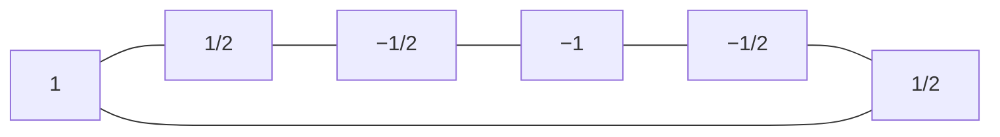

# Neighboring differences and overall spread

Wirtinger's inequality is useful here because it connects two ways of looking at a changing pattern: the difference between neighbors, and how far the whole pattern lies from its average.

Imagine six readings around a ring. Their average is zero:

Squaring and adding the readings gives an overall spread of **3**. Squaring and adding the six differences between neighbors also gives **3**. The last-to-first comparison counts too.

The proof applies to any real readings on a finite periodic ring after their average is subtracted. For at least two sites, it gives a positive lower bound on the neighboring differences needed to support that overall spread. A nonconstant pattern cannot have zero differences at every neighboring pair.

## What Lean proves

Write `E` for the sum of squared deviations from the average and `D` for the sum of squared neighboring differences. For a ring of `n` sites,

$$\lambda E \le D, \qquad \lambda = 2 - 2\cos(2\pi/n).$$

The constant `λ` is the ring's **spectral gap**. Here “gap” means the number controlling this bound; it is not a missing piece of a material path. The [Wirtinger proof](https://github.com/NousVolition/discrete-gap-inequalities-lean/blob/f59b86b915af55ccf55223761f21d2116883a0a7/Wirtinger.lean#L168) establishes the inequality. Its [sharpness result](https://github.com/NousVolition/discrete-gap-inequalities-lean/blob/f59b86b915af55ccf55223761f21d2116883a0a7/Wirtinger.lean#L228) supplies a cosine pattern attaining equality for `n ≥ 3`, so this constant cannot be increased for all patterns.

The companion [RingDecay proof](https://github.com/NousVolition/discrete-gap-inequalities-lean/blob/f59b86b915af55ccf55223761f21d2116883a0a7/RingDecay.lean#L191) checks a particular smoothing rule:

$$u_j^{\mathrm{new}}=u_j+\tau(u_{j+1}-2u_j+u_{j-1}).$$

This rule preserves the average. For `0 ≤ τ ≤ 1/4`, it bounds the new spread by `(1 − τλ)² E`. Repeating it drives the spread to zero when `n ≥ 2` and `0 < τ ≤ 1/4`.

For the six readings above, `λ = 1`. Taking `τ = 1/4` gives this arithmetic example:

| | Readings in ring order | Sum of squared deviations |
| --- | --- | --- |
| Before | 1, 1/2, −1/2, −1, −1/2, 1/2 | 3 |
| After one smoothing step | 3/4, 3/8, −3/8, −3/4, −3/8, 3/8 | 27/16 = 1.6875 |

This pattern reaches the stated bound. The table illustrates the already proved rule; it is not a new fluid simulation or a newly compiled Lean example.

## How it connects to Hug and SIMS

For Hug, this gives a checked benchmark for a smoothing step whose update and boundaries match the rule above. It tells us how neighboring differences constrain the total spread, and how fast that spread must shrink under this rule. Applying it to a particular Hug field requires matching that field's update and boundary conditions first. Coupled evolution, writes and holds need their own treatment.

The periodic ring is the mathematical grid used in these proofs. It does not require the carried water path to close into a loop. The [single-system meaning](../../research/comparisons/hug-navier-single-system-scope-correction.md#meaning-to-preserve-across-implementations) remains unchanged.

For SIMS, the useful connection is the question **“Which differences does this observation capture?”** Wirtinger answers that for all neighboring comparisons on its ring. The [SIMS observation proofs](../../research/sims-continuing-evidence/README.md) ask a different question: whether the recorded clues distinguish two possible causes. Wirtinger supplies no additional claim about a listener's recognition or private state.

## Checked source and run

These are existing proofs in [NousVolition/discrete-gap-inequalities-lean](https://github.com/NousVolition/discrete-gap-inequalities-lean/tree/f59b86b915af55ccf55223761f21d2116883a0a7), revision `f59b86b915af55ccf55223761f21d2116883a0a7`. [GitHub run 44839304050](https://github.com/NousVolition/discrete-gap-inequalities-lean/actions/runs/44839304050) passed the build and axiom audit. Its logs include the named Wirtinger and RingDecay targets in the [source record](source.json), using only `propext`, `Classical.choice` and `Quot.sound`. This addition links and explains that evidence; it adds no theorem to Hug/SIMS.

AI-generated; dictated and directed by NousVolition. Explanation and diagram prepared by this Codex chat; the linked proof files retain their own credits.
