# Tree of the viscous time reversal statements

Each statement has its own page. Every page shows the Lean statement exactly as checked, then plain-words versions in English, Español, Français, Deutsch, 中文, 日本語, العربية, हिन्दी and Português, and the statement in Lean/Unicode, ASCII and LaTeX. Only the Lean text is checked; the other versions are reading aids. The terms mentor, student, gap, split, freeze, wall and tick are kept as written in every language.

Time is counted from the 0,0 split (tick 2): 0 holds the past and the future together, and forward and back are both counted from it.

```mermaid
graph TD
  n0[reverseTime_twice] --> n1[timeReverse_derivative]
  n1[timeReverse_derivative] --> n2[viscosity_reversal]
  n1[timeReverse_derivative] --> n3[whole_rhs_reversal]
  n4[forwardFactor_derivative] --> n6[forward_damping]
  n5[backwardFactor_derivative] --> n7[backward_amplification]
  n6[forward_damping] --> n8[forward_strict_damping]
  n7[backward_amplification] --> n9[backward_strict_amplification]
  n7[backward_amplification] --> n10[higher_frequency_amplification]
  n6[forward_damping] --> n11[factor_cancellation]
  n7[backward_amplification] --> n11[factor_cancellation]
  n12[negative_step_reverses_rate] --> n13[double_sign_flip_restores_forward]
  n14[split_at_tick_two] --> n15[reverse_twice]
  n0[reverseTime_twice] --> n15[reverse_twice]
  n15[reverse_twice] --> n16[reversal_keeps_one]
  n16[reversal_keeps_one] --> n22[share_change_undone]
  n15[reverse_twice] --> n17[reflect_flips_margin]
  n17[reflect_flips_margin] --> n18[forward_gap_becomes_backward_overlap]
  n17[reflect_flips_margin] --> n19[touch_stays_touch]
  n18[forward_gap_becomes_backward_overlap] --> n20[tick23_gap_reverses_to_overlap]
  n14[split_at_tick_two] --> n21[freeze_at_tick23_both_ways]
  n21[freeze_at_tick23_both_ways] --> n20[tick23_gap_reverses_to_overlap]
  n23[wall_is_single_system_viscosity] --> n24[thin_and_thick_wall]
  n24[thin_and_thick_wall] --> n25[wall_between_thin_and_thick]
  n25[wall_between_thin_and_thick] --> n26[reversed_wall_range]
  n2[viscosity_reversal] --> n27[wall_flips_under_reversal]
  n15[reverse_twice] --> n27[wall_flips_under_reversal]
  n26[reversed_wall_range] --> n27[wall_flips_under_reversal]
  n27[wall_flips_under_reversal] --> n33[backward_step_is_reversed_wall]
  n13[double_sign_flip_restores_forward] --> n33[backward_step_is_reversed_wall]
  n25[wall_between_thin_and_thick] --> n28[forward_wall_only_damps]
  n6[forward_damping] --> n28[forward_wall_only_damps]
  n25[wall_between_thin_and_thick] --> n29[backward_wall_only_amplifies]
  n7[backward_amplification] --> n29[backward_wall_only_amplifies]
  n28[forward_wall_only_damps] --> n31[thick_wall_damps_most]
  n29[backward_wall_only_amplifies] --> n30[thick_wall_amplifies_most]
  n11[factor_cancellation] --> n32[wall_factors_multiply_to_one]
  n28[forward_wall_only_damps] --> n34[wall_takes_forward_from_split]
  n29[backward_wall_only_amplifies] --> n35[wall_gives_backward_from_split]
  n34[wall_takes_forward_from_split] --> n36[both_directions_add]
  n35[wall_gives_backward_from_split] --> n36[both_directions_add]
```

- Time reversal and ripple factors
  - [reverseTime_twice](pages/reverseTime_twice.md) → [timeReverse_derivative](pages/timeReverse_derivative.md) → [viscosity_reversal](pages/viscosity_reversal.md), [whole_rhs_reversal](pages/whole_rhs_reversal.md)
  - [forwardFactor_derivative](pages/forwardFactor_derivative.md) → [forward_damping](pages/forward_damping.md) → [forward_strict_damping](pages/forward_strict_damping.md)
  - [backwardFactor_derivative](pages/backwardFactor_derivative.md) → [backward_amplification](pages/backward_amplification.md) → [backward_strict_amplification](pages/backward_strict_amplification.md), [higher_frequency_amplification](pages/higher_frequency_amplification.md)
  - [factor_cancellation](pages/factor_cancellation.md)
  - [negative_step_reverses_rate](pages/negative_step_reverses_rate.md) → [double_sign_flip_restores_forward](pages/double_sign_flip_restores_forward.md)
- The 0,0 split: [split_at_tick_two](pages/split_at_tick_two.md) → [reverse_twice](pages/reverse_twice.md)
  - Shares: [reversal_keeps_one](pages/reversal_keeps_one.md) → [share_change_undone](pages/share_change_undone.md)
  - Gap, touch, overlap: [reflect_flips_margin](pages/reflect_flips_margin.md) → [forward_gap_becomes_backward_overlap](pages/forward_gap_becomes_backward_overlap.md), [touch_stays_touch](pages/touch_stays_touch.md)
    - Tick 23: [freeze_at_tick23_both_ways](pages/freeze_at_tick23_both_ways.md) → [tick23_gap_reverses_to_overlap](pages/tick23_gap_reverses_to_overlap.md)
  - The wall run backward: [wall_flips_under_reversal](pages/wall_flips_under_reversal.md) → [backward_step_is_reversed_wall](pages/backward_step_is_reversed_wall.md)
- The wall: [wall_is_single_system_viscosity](pages/wall_is_single_system_viscosity.md) → [thin_and_thick_wall](pages/thin_and_thick_wall.md) → [wall_between_thin_and_thick](pages/wall_between_thin_and_thick.md) → [reversed_wall_range](pages/reversed_wall_range.md)
  - Forward: [forward_wall_only_damps](pages/forward_wall_only_damps.md) → [thick_wall_damps_most](pages/thick_wall_damps_most.md)
  - Backward: [backward_wall_only_amplifies](pages/backward_wall_only_amplifies.md) → [thick_wall_amplifies_most](pages/thick_wall_amplifies_most.md)
  - Both: [wall_factors_multiply_to_one](pages/wall_factors_multiply_to_one.md)
- Counting from the split in both directions: [wall_takes_forward_from_split](pages/wall_takes_forward_from_split.md), [wall_gives_backward_from_split](pages/wall_gives_backward_from_split.md) → [both_directions_add](pages/both_directions_add.md)
